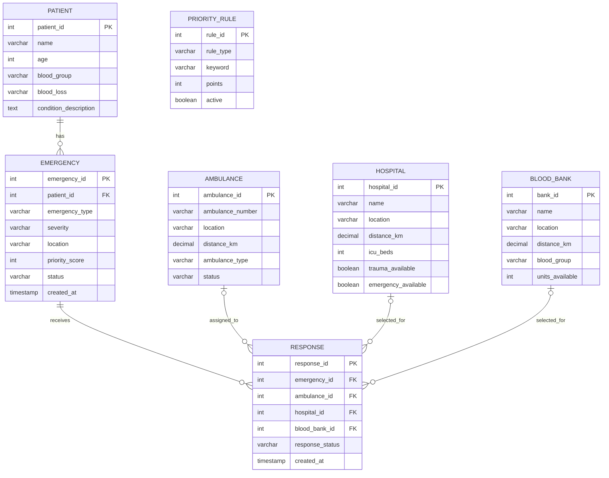

# ERCS Database Design

ERCS is an academic emergency-response simulation. Its data and priority rules are not for real medical or dispatch decisions.

## ER Diagram



`PRIORITY_RULE` is a separate configuration relation. It has no foreign key because Java reads its active rules when calculating a demonstration score.

## Relational Schema

```text
PATIENT(patient_id PK, name, age, blood_group, blood_loss, condition_description)
EMERGENCY(emergency_id PK, patient_id FK, emergency_type, severity, location, priority_score, status, created_at)
AMBULANCE(ambulance_id PK, ambulance_number, location, distance_km, ambulance_type, status)
HOSPITAL(hospital_id PK, name, location, distance_km, icu_beds, trauma_available, emergency_available)
BLOOD_BANK(bank_id PK, name, location, distance_km, blood_group, units_available)
RESPONSE(response_id PK, emergency_id FK, ambulance_id FK NULL, hospital_id FK NULL, blood_bank_id FK NULL, response_status, created_at)
PRIORITY_RULE(rule_id PK, rule_type, keyword, points, active, UNIQUE(rule_type, keyword))
```

## Functional Dependencies

```text
patient_id → name, age, blood_group, blood_loss, condition_description
emergency_id → patient_id, emergency_type, severity, location, priority_score, status, created_at
ambulance_id → ambulance_number, location, distance_km, ambulance_type, status
hospital_id → name, location, distance_km, icu_beds, trauma_available, emergency_available
bank_id → name, location, distance_km, blood_group, units_available
response_id → emergency_id, ambulance_id, hospital_id, blood_bank_id, response_status, created_at
rule_id → rule_type, keyword, points, active
(rule_type, keyword) → rule_id, points, active
```

The last dependency is enforced by the unique key. The other dependencies use primary keys. The design keeps patient, emergency, resource, response, and scoring-rule facts separate and is in 3NF for these stored facts.

## Relational Algebra

Notation: `σ` selection, `π` projection, `⋈` join, `τ` sort, `γ` group/aggregate, and `⟕` left outer join.

### Pending emergencies with patient details

```text
π emergency_id, name, emergency_type, severity, priority_score, location
  (σ status = 'PENDING' (EMERGENCY ⋈_{EMERGENCY.patient_id = PATIENT.patient_id} PATIENT))
```

### Available ambulances, nearest first

```text
τ distance_km ASC (σ status = 'AVAILABLE' (AMBULANCE))
```

### Trauma hospitals with ICU capacity

```text
τ distance_km ASC (σ emergency_available = TRUE ∧ trauma_available = TRUE ∧ icu_beds > 0 (HOSPITAL))
```

### Blood-bank records with O+ stock

```text
τ distance_km ASC (σ blood_group = 'O+' ∧ units_available > 0 (BLOOD_BANK))
```

### Response history with selected resources

```text
π response_id, emergency_id, response_status, ambulance_number, HOSPITAL.name, blood_group, units_available
  (((RESPONSE ⟕_{RESPONSE.ambulance_id = AMBULANCE.ambulance_id} AMBULANCE)
    ⟕_{RESPONSE.hospital_id = HOSPITAL.hospital_id} HOSPITAL)
    ⟕_{RESPONSE.blood_bank_id = BLOOD_BANK.bank_id} BLOOD_BANK)
```

### Pending-emergency count by severity

```text
γ severity; COUNT(emergency_id) → pending_count (σ status = 'PENDING' (EMERGENCY))
```
